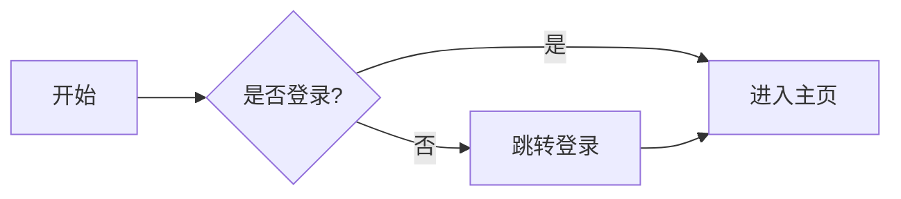

# 更新日志 (CHANGELOG)

> 最新改动追加在最前面。

## v1.4.6.202609042219

### 修复

- **PHP 7.4（Linux）下中文开头文件名被截断**：如 `支付结果通知[notify][3].md` 被解析成 title/route 均为 `[notify][3]`，且 sort 退化为 filemtime。

  - 根因：`pathinfo()` 在 Linux + 非 UTF-8 locale 环境下会错误截断**以多字节字符（中文）开头**的文件名（`支付结果通知[notify][3]` 被截成 `[notify][3]`）；以 ASCII 开头的文件（`API接口支付` 等）和目录（不走 pathinfo）不受影响。

  - 修复：4 个接口文件全部弃用 `pathinfo()`，改用字节级 `strrpos`/`substr` 手动去扩展名和取扩展名，不受 locale 影响，PHP 5.6 \~ 8.4 行为完全一致。

  - 验证：用用户服务器实际出错的 10 个文件名 + 5 个边界用例（无括号/标题含点/多层点/无扩展名）断言全部通过；与 pathinfo 版在正常环境输出 0 差异（语义完全等价）。

### 改动文件

- `api/sidebar.php` / `api/search.php` / `api/sidebar_php56.php` / `api/search_php56.php` — `parseFileName()` 去扩展名、扩展名检查均改为字节级 `strrpos`/`substr`

## v1.4.5.202609042210

### 修复

- **PHP 7.2 \~ 8.4 全兼容**：`api/sidebar.php`、`api/search.php` 使用了 PHP 8.0+ 才有的 `str_starts_with()`，在 PHP < 8.0 环境直接 Fatal error（如 `Call to undefined function str_starts_with()`）。现加入 `function_exists` 兜底 polyfill：

  - 用 `strncmp()` 做字节级前缀比较，二进制安全，UTF-8 多字节字符无影响，语义与 PHP 8 原生完全一致（含空前缀返回 true 的行为）

  - 已用 10 组用例（多字节/空前缀/needle 更长/空 haystack/业务用例）比对原生函数，结果 10/10 一致

- `api/search.php` 增加 `mb_substr` 降级：mbstring 扩展未启用时按字节截断，避免 Fatal error。

### 新增

- `api/sidebar_php56.php` / `api/search_php56.php`：**PHP 5.6 独立兼容版**，与默认版功能完全一致：

  - 不使用 `str_starts_with()`（直接用 `strncmp` 字节级前缀比较替代）

  - 不依赖 mbstring 扩展（`mb_substr` 自动降级为 `substr`）

  - 不使用任何 PHP 7+ 语法特性

  - 部署方式：PHP 5.6 环境下将文件重命名为 `sidebar.php` / `search.php`（或修改前端请求地址）

### 改动文件

- `api/sidebar.php` — 加 `str_starts_with` polyfill（默认版本，PHP 7.2 \~ 8.4）

- `api/search.php` — 加 `str_starts_with` polyfill + `mb_substr` 降级

- `api/sidebar_php56.php` — 新增（PHP 5.6 兼容版目录接口）

- `api/search_php56.php` — 新增（PHP 5.6 兼容版搜索接口）

## v1.4.4.202607311600

### 新增

- **首次加载进度条**：页面首次打开（硬加载）时显示屏幕居中的简约横线进度条，侧边栏与首篇文档渲染完成后淡出移除。

  - 设计：128px 宽、2px 高的细线轨道，流光渐变滑块循环滑动，跟随主题底色，不突兀

  - 触发：仅首次加载显示，SPA hash 路由切换不触发

  - 兜底：8 秒超时强制隐藏，防止接口异常时卡在加载态

  - 无障碍：尊重 `prefers-reduced-motion`，关闭动画时滑块静态显示

### 改动文件

- `index.html` — body 开头加 `#app-loader` DOM；初始化链改为 `initTree().then(loadContent).finally(hideAppLoader)` + 8s 兜底；main.js/main.css 版本号 → `?v=202607312000`

- `assets/main.css` — 新增 `.app-loader` 系列样式（轨道+滑块+淡出+reduced-motion）

- `assets/main.js` — 新增 `hideAppLoader()` 函数

## v1.4.3.202607311540

### 修复

- **流程图/类图/甘特图渲染成 16x16 小方块或宽度为 0**：

  - 根因：`index.html` 内联样式 `[id^="dmermaid"]{display:none!important}` 与 `main.css` 同名规则，会匹配并隐藏 mermaid 渲染时创建的临时测量容器。该容器是 `<div>` 元素，其 id 为 `d` + 传入 render 的 id（即 `dmermaid-svg-xxx`），被 `display:none` 后 flowchart/classDiagram/gantt 依赖的 foreignObject 内 HTML 文字尺寸测量全部返回 0，mermaid 退回默认 16x16 viewBox。时序图/饼图/用户旅程图使用 SVG `<text>`（getBBox 不依赖 display），故不受影响。

  - 修复：将选择器限定为 `svg[id^="dmermaid"]`，只隐藏渲染失败时生成的错误 SVG（svg 元素），不再误伤临时测量 div。

  - 验证：流程图 viewBox 从 `-8 -8 16 16` 变为 `-8 -8 912 208`，甘特图从 `0 0 0 220` 变为 `0 0 599 220`，类图从 `-8 -8 16 16` 变为 `0 0 301 343`。

- **资源缓存导致修改不生效**：给 main.js、main.css 引用加版本号查询参数 `?v=202607311900`，绕过浏览器缓存。

### 改动文件

- `index.html` — 内联 style 选择器改为 `svg[id^="dmermaid"]`；main.js/main.css 引用加版本号 `?v=202607311900`

- `assets/main.css` — `[id^="dmermaid"]` 改为 `svg[id^="dmermaid"]`，更新注释说明根因

- `assets/main.js` — 删除临时调试日志（`[Mermaid Debug]` console.log）

## v1.4.2.202607312350

### 修复

- **图表无法正确渲染（流程图、甘特图、类图等）**：

  - 根因：`useMaxWidth: false` 会破坏 mermaid 10.9.1 中 classDiagram、gantt 等图表类型的内部布局计算（它们依赖 max-width 值确定画布尺寸，缺失时导致 SVG 路径计算异常、negative width 错误）。

  - 修复：改回 mermaid 默认的 `useMaxWidth: true`，确保所有图表类型正确渲染。渲染后手动移除 SVG 的 `max-width` inline style 并用 viewBox 尺寸替换 `width="100%"`，让图表保持真实尺寸同时支持拖拽缩放。

- **全屏后图表偏移到左上角且倍率丢失**：

  - 根因：全屏时移动了 DOM 并重新调用 `bindPanZoom()`，导致 transform 状态被重置为 `scale(1) translate(0,0)`。

  - 修复：改为 CSS class 切换方案。点击全屏按钮只添加 `.mermaid-card-fullscreen` class，CSS 控制 `position:fixed; inset:0` 全屏。不移动 DOM、不重新绑定交互，viewport 的 transform 完全保留。退出时移除 class 即可。

### 改动文件

- `assets/main.js` — `useMaxWidth` 改回 `true`；SVG 渲染后移除 max-width 并设置真实尺寸；`bindFullscreen` 重写为 CSS class 切换

- `assets/main.css` — 全屏样式从遮罩层改为 `.mermaid-card-fullscreen` class 控制

## v1.4.1.202607312340

### 修复

- **全屏模式溢出问题**：重写全屏功能，去除背景遮罩层，stage 直接撑满整个视口。

  - 全屏容器 `position:fixed; inset:0` 占满屏幕，顶部仅一条窄工具栏（含关闭按钮和操作提示）

  - stage 用 `flex:1` 填满剩余空间，图表不再溢出

  - 不再克隆 DOM，直接移动原始 stage 到全屏容器，退出时恢复原位

- **flowchart 只显示小点**：根因是 `htmlLabels:false` 导致中文节点标签不渲染。

  - 改回 `htmlLabels:true`（之前的 negative width 错误来自 gitGraph，不是 flowchart）

  - 将 chart 文档中有 bug 的 gitGraph 替换为稳定的 sequenceDiagram

- **源码视图文字不可读**：mermaid 源码区背景过浅导致文字看不清。

  - 改为深色背景 `#1e2a3a` + 浅色文字 `#e0e0e0`，高对比度易于阅读

- **图表背景格栅**：去除棋盘格背景图案，改为固定纯色 `#fafafa`（暗色模式 `#1a1a2e`）

### 改动文件

- `assets/main.js` — mermaid 配置改回 `htmlLabels:true`；重写 `bindFullscreen()` 为真正全屏

- `assets/main.css` — stage 改纯色背景、source 改深色高亮、fullscreen 重写为全屏布局

- `docs/进阶示例[advanced][2]/图表进阶[chart][0].md` — gitGraph 替换为 sequenceDiagram

## v1.4.0.202607312330

### 新增

- **Mermaid 图表交互能力全面升级**：重构图表渲染模块，从单纯展示升级为可交互的图表卡片。

  - **拖拽平移**：在图表区域按住鼠标拖动即可平移查看大图。

  - **滚轮缩放**：滚轮缩放以鼠标位置为中心，缩放范围 0.2x \~ 5x。

  - **双击复位**：双击图表区域快速复位到 1:1 状态。

  - **工具栏**：每个图表卡片顶部新增工具栏，含三个按钮：

    - 源码切换按钮（`</>` 图标）：点击切换显示 Mermaid 源码 / 图表渲染

    - 复位按钮（循环箭头图标）：点击复位缩放和平移

    - 全屏按钮（四角展开图标）：点击进入全屏沉浸查看，ESC 或点击遮罩退出

  - **棋盘格背景**：图表显示区采用棋盘格背景，清晰标识可交互区域。

  - **全屏模式**：全屏遮罩内同样支持拖拽和缩放，适合查看复杂大型图表。

  - **源码查看**：渲染失败的图表自动显示源码区和错误提示，方便作者排查。

### 修复

- **gitGraph 和 flowchart 渲染失败问题**：

  - 根因：mermaid 10.9.1 的 `htmlLabels: true` 在中文节点标签场景下会触发 SVG 路径计算 bug，产生 `negative width` 错误。

  - 修复：将 mermaid 初始化配置改为 `htmlLabels: false`，所有图表类型（flowchart、sequence、journey、gantt、pie）的 `useMaxWidth` 统一设为 `false`，让 SVG 使用真实尺寸便于拖拽缩放。

  - 已验证：开发说明的架构图（flowchart LR）和图表进阶页的所有图表均正常渲染。

### 改动文件

- `assets/main.js` — 重写 `renderMermaid()`，新增 `buildMermaidCard()`、`bindPanZoom()`、`bindFullscreen()` 三个函数

- `assets/main.css` — 替换 Mermaid 样式块，新增卡片、工具栏、舞台、源码区、全屏遮罩等样式

## v1.3.1.202607312300

### 修复

- **Mermaid 错误 SVG 残留问题**：当 Mermaid 图表语法错误时，mermaid 10.x 会向 `body` 插入错误 SVG（显示「Syntax error in text」），切换页面后仍残留覆盖内容。

  - 尝试了 JS `el.remove()`、`setTimeout` 延迟清理、`MutationObserver` 监听删除、`mermaid.parse()` 预检等方案，均不可靠（mermaid 10.x 内部异步插入机制复杂）。

  - 最终方案：在 `index.html` 中添加内联 `<style>[id^="dmermaid"]{display:none!important}</style>`，从 CSS 层面隐藏所有 mermaid 临时容器和错误 SVG。成功渲染的图表 SVG id 以 `mermaid-svg` 开头（无 d 前缀），不受影响。

  - 在 `assets/main.js` 的 `renderMermaid()` 中保留 `cleanupMermaidTmpDom()` 作为辅助清理。

  - 图表间增加 50ms 延迟，避免连续渲染时 mermaid 内部状态污染。

- **文档 fetch 缓存问题**：`fetch` 请求未禁用缓存，修改 `.md` 文件后浏览器可能仍读取旧内容。改为 `fetch(url, { cache: 'no-cache' })`。

- **图表进阶文档调整**：将 mermaid 10.9.1 中存在 SVG 路径计算 bug 的 `stateDiagram-v2` 和 `erDiagram` 替换为稳定的 `gitGraph` 和 `classDiagram`，确保所有示例图表都能正常渲染。

### 改动文件

- `index.html` — 添加内联 `<style>` 隐藏 dmermaid 元素

- `assets/main.js` — 简化 `renderMermaid()` 逻辑、图表间加延迟、fetch 禁用缓存

- `assets/main.css` — 保留 `[id^="dmermaid"]` 隐藏规则（与内联 style 互为兜底）

- `docs/进阶示例[advanced][2]/图表进阶[chart][0].md` — 替换不稳定图表类型

## v1.3.0.202607312230

### 新增

- **离线部署支持**：将所有 CDN 资源下载到本地 `assets/vendor/` 目录，项目可在完全无外网环境下运行。

  - 下载并本地化的资源（共 15 个主资源 + 60 个 KaTeX 字体）：

    - `markdown-it@13.0.2` — Markdown 解析引擎

    - `prismjs@1.29.0` — 代码高亮（核心 + 8 个语言组件 + tomorrow 主题）

    - `katex@0.16.9` — 数学公式（JS + CSS + 60 个字体文件 woff2/woff/ttf）

    - `markdown-it-texmath@1.0.0` — 公式语法插件

    - `fuse.js@6.6.2` — 模糊搜索

    - `mermaid@10.9.1` — 图表绘制

  - **关键处理**：KaTeX CSS 内通过相对路径 `fonts/...` 引用字体，已自动解析并下载全部 60 个关联字体文件到 `katex@0.16.9/dist/fonts/`，确保公式字体在离线环境下正常显示。

  - `index.html` 中所有 `<link>` 与 `<script>` 的 CDN 引用全部改为 `assets/vendor/...` 本地路径。

  - 已浏览器实测：无任何 cdn.jsdelivr.net 请求，无 404，markdownit/Prism/Fuse/katex/mermaid 全部加载成功，5 个 Mermaid 图表 + 4 个 KaTeX 公式渲染正常。

### 改动文件

- `index.html` — 15 处 CDN 引用改为本地 `assets/vendor/` 路径

- `assets/vendor/` — 新增本地化资源目录（含 KaTeX 字体）

## v1.2.1.202607312200

### 重写

- **示例文档全量重写**：删除 `docs` 目录下原有零散示例，按项目实际功能重新编写一套结构化示例文档，覆盖介绍、快速开始、部署、命名规则、渲染示例、更新日志、开发说明，并新增两个多级菜单演示文件夹。

  - 一级文档（7 篇）：

    - `项目介绍[home][0].md` — 系统概述、核心特性、技术栈、项目结构

    - `快速开始[quick-start][1].md` — 5 分钟启动与第一篇文档

    - `部署指南[deploy][2].md` — PHP/Nginx/Apache 三种部署方式、子目录部署、后端替换

    - `命名规则[naming][3].md` — `标题[路由][排序]` 公式详解、隐藏文件、多级菜单、最佳实践

    - `渲染示例[render][4].md` — 文本、代码高亮、KaTeX 公式、Mermaid 图表、表格全集演示

    - `更新日志[changelog][5].md` — 同步项目版本演进

    - `开发说明[dev][6].md` — 架构图、数据流、后端/前端扩展、调试排错

  - 多级菜单演示（2 个文件夹，4 篇文档）：

    - `基础教程[basic][1]/` 下：`环境准备[env][0].md`、`撰写文档[write][1].md`

    - `进阶示例[advanced][2]/` 下：`图表进阶[chart][0].md`、`公式进阶[formula][1].md`

  - 已浏览器实测：菜单结构、多级展开、Mermaid 图表（5 个）、KaTeX 公式（4 个）、代码高亮均正常渲染。

## v1.2.0.202607312150

### 新增

- **左侧菜单自动/手动收起与展开（统一控制）**：

  - 引入统一状态 `body.sidebar-collapsed`，自动收起与手动收起共用同一套状态机，不再出现两套逻辑冲突。

  - 屏幕宽度 <=1024px 时自动收起左侧菜单，>1024px 时自动展开；跨越阈值时才切换，同区间内手动操作不被重置。

  - 收起后左下角出现浮动圆形按钮，点击可重新展开；侧边栏底部的折叠按钮点击可收起。

  - 收起/展开带 0.3s 过渡动画，主内容区 margin 同步过渡，视觉顺滑。

  - <=768px 仍走原有的移动端抽屉模式（汉堡按钮 + 遮罩），与 PC 端收起互不干扰。

- **右侧目录手动收起与展开**：

  - 目录标题栏右侧新增收起按钮（chevron 图标），点击切换 `body.toc-collapsed`。

  - 收起后右侧边缘出现浮动按钮，点击可重新展开目录。

  - 收起后主内容区 margin-right 自动归零，最大化阅读宽度。

### 改动文件

- `index.html`：侧边栏底部折叠按钮加 id、新增左侧浮动展开按钮；TOC 标题改为 flex 布局并加收起按钮、新增 TOC 浮动展开按钮。

- `assets/main.js`：新增 `LayoutCtrl` 模块（统一收起/展开控制 + resize 监听），在 DOM 定义后初始化。

- `assets/main.css`：`.toc-title` 改 flex；新增 `.toc-toggle-btn`、`#sidebar-float-btn`、`#toc-float-btn` 样式；新增 `body.sidebar-collapsed` / `body.toc-collapsed` 状态样式；sidebar 与 main 增加过渡动画；移动端隐藏浮动按钮。

## v1.1.1.202607312100

### 修复

- **目录访问未带结尾斜杠导致 404 的问题**：当项目部署在子目录且用户访问时未补斜杠（如 `http://10.0.0.2:8000/doc` 而非 `/doc/`）时，浏览器会把最后一段当成文件名，导致 base 计算少一层目录，资源请求落到 `/assets/...` 而非 `/doc/assets/...`，出现 404。

  - 改进 `index.html` 头部的 base 计算逻辑：检测 pathname 最后一段不含点（无扩展名）时，视为目录访问，base 补全该段并加斜杠。

  - 同时通过 `history.replaceState` 静默修正地址栏为带斜杠形式，避免后续 hash 路由与相对路径混乱。

  - 已验证：`/doc`、`/doc/`、`/doc/index.html`、根目录 `/` 四种访问方式 base 均正确，资源无 404。

## v1.1.0.202607312000

### 修复

- **资源路径引入问题**：项目在移植到二级 / 三级 / 更深层子目录时，CSS、JS、PHP 接口等资源会出现 404 找不到的问题。

  - 在 `index.html` 头部增加动态计算逻辑，根据当前页面 URL 解析出项目根目录，并同步写入 `<base>` 标签。

  - 所有的相对路径引用（`<link>`、`<script>`、`fetch()`）都会基于该 base 解析，从而无论项目部署在网站根目录还是任意子目录，资源都能正确加载。

  - UI 与文件结构保持不变，零侵入修复。

### 新增

- **Mermaid 图表渲染插件**：在 Markdown 中可直接编写图表，支持流程图、时序图、类图、状态图、甘特图、饼图、ER 图、用户旅程图等。

  - 引入 `mermaid@10.9.1`（CDN）。

  - 在 `assets/main.js` 中新增 `renderMermaid()` 函数，自动识别 markdown-it 输出的 ` ```mermaid ` 代码块并替换为可视化 SVG 图表。

  - 自动适配系统深色模式（浅色用 `default` 主题，深色用 `dark` 主题）。

  - 在 `assets/main.css` 中新增 `.mermaid-render` 容器样式，卡片化展示，与正文排版协调。

  - 渲染失败时保留原始代码块并添加红色虚线边框提示，便于作者排查语法错误。

### 用法示例

在任意 `.md` 文档中写入：

````

````

即可在页面中渲染出对应的流程图。
