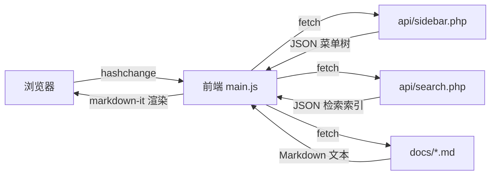

# 开发说明

面向二次开发者，解析系统架构与扩展方式。代码完全白盒，可自由魔改。

## 架构概览



## 核心数据流

### 1. 菜单构建（`initTree`）

前端启动时调用 `api/sidebar.php`，后端递归扫描 `docs/` 目录，按 `标题[路由][排序]` 解析每个文件与文件夹，返回树状 JSON：

```json
{
    "data": [
        {
            "type": "file",
            "title": "项目介绍",
            "route": "home",
            "fullRoute": "home",
            "actualPath": "项目介绍[home][0].md",
            "sortWeight": 0
        },
        {
            "type": "dir",
            "title": "基础教程",
            "route": "basic",
            "fullRoute": "basic",
            "children": [ ... ]
        }
    ]
}
```

前端在 `renderSidebar` 阶段同步构建 `window.routeMap` 哈希表：

```javascript
window.routeMap = {
    "home": "项目介绍[home][0].md",
    "basic/env": "基础教程[basic][1]/环境准备[env][0].md"
};
```

### 2. 路由与渲染（`loadContent`）

监听 `hashchange` 事件，从 hash 提取路由 → 查 `routeMap` 得到物理路径 → `fetch('docs/' + path)` 拿到 Markdown 文本 → `md.render()` 转 HTML → 写入 `#content-body` → `Prism.highlightAllUnder` 高亮代码 → `renderMermaid()` 渲染图表 → `generateTOC()` 生成大纲。

### 3. 全文搜索（`SearchSys`）

首次唤起搜索框时拉取后端接口（`/action/search`），后端聚合所有文档纯文本返回 JSON 数组。前端用 Fuse.js 建立模糊匹配索引，搜索时支持关键词高亮与摘要截取。

## 后端扩展

### 修改命名解析正则

当前正则位于 `api/main.php`：

```php
preg_match('/^([^\[\]]+)(?:\[([^\[\]]+)\])?(?:\[(\d+)\])?$/', $nameWithoutExt, $matches);
```

如需扩展第四个维度（如图标），改为：

```php
preg_match('/^([^\[\]]+)(?:\[([^\[\]]+)\])?(?:\[(\d+)\])?(?:\[(icon-[a-z]+)\])?$/', $nameWithoutExt, $matches);
```

然后在返回数组中加 `icon` 字段，前端 `renderSidebar` 拼接对应 HTML 即可。

### 搜索索引优化

大规模文档库（万篇以上）建议：

1. **加缓存**：文档更新时触发重建 JSON，平时从缓存读取。
2. **剔除代码块**：用正则去掉 ```` ``` ```` 内的内容，专注索引人类语言，可压缩 60% 体积。

## 前端扩展

### 新增代码高亮语言

在 `index.html` 底部按依赖顺序追加 Prism 组件（注意 PHP 必须在 `markup-templating` 之后）：

```html
<script src="https://cdn.jsdelivr.net/npm/prismjs@1.29.0/components/prism-rust.min.js"></script>
```

### 修改主题配色

`assets/main.css` 顶部 CSS Variables：

```css
:root {
    --vp-c-brand: #3451b2;          /* 核心品牌色 */
    --vp-c-brand-light: #3a5ccc;    /* 悬浮态 */
    --vp-sidebar-width: 272px;      /* 侧边栏宽度 */
}
```

深色模式在 `@media (prefers-color-scheme: dark)` 中覆盖即可。

### 挂载 markdown-it 插件

例如实现 Vitepress 风格的容器块：

```markdown
::: tip 提示
重要信息
:::
```

引入 `markdown-it-container`，在 `assets/app.js`（应用启动入口）中注册：

```javascript
md.use(window.markdownitContainer, 'tip', {
    render: function (tokens, idx) {
        var m = tokens[idx].info.trim().match(/^tip\s+(.*)$/);
        if (tokens[idx].nesting === 1) {
            return '<div class="custom-block tip"><p class="custom-block-title">' +
                md.utils.escapeHtml(m[1] || 'TIP') + '</p>\n';
        } else {
            return '</div>\n';
        }
    }
});
```

## 调试排错

| 症状 | 排查 |
|---|---|
| 点击菜单 404 | 检查 `main.js` 中 `fetchUrl` 是否对路径片段做了 `encodeURIComponent` |
| 代码块报错 `tokenizePlaceholders` | `prism-markup-templating.min.js` 必须在 `prism-php.min.js` 之前 |
| CDN 资源 404 | 国内网络污染，替换为稳定镜像或下载到本地 |
| 侧边栏移动端撕裂 | `resize` 钩子中确保清理 `sidebar-collapsed` 类，避免 PC 端状态残留 |
| Mermaid 图表不渲染 | 检查代码块语言标识是否为 `mermaid`，控制台查看具体语法错误 |
