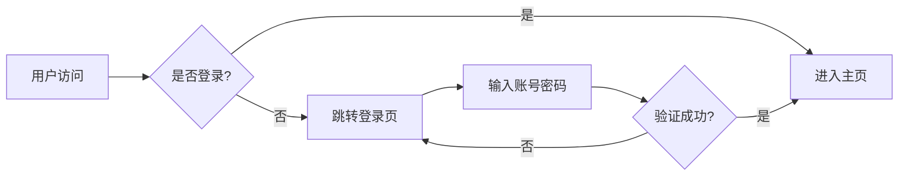
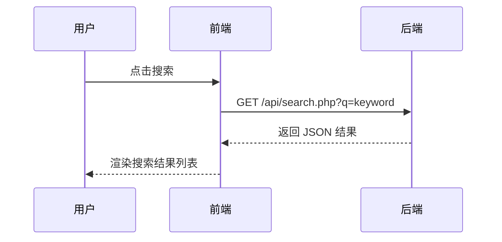
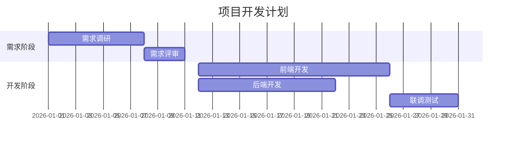
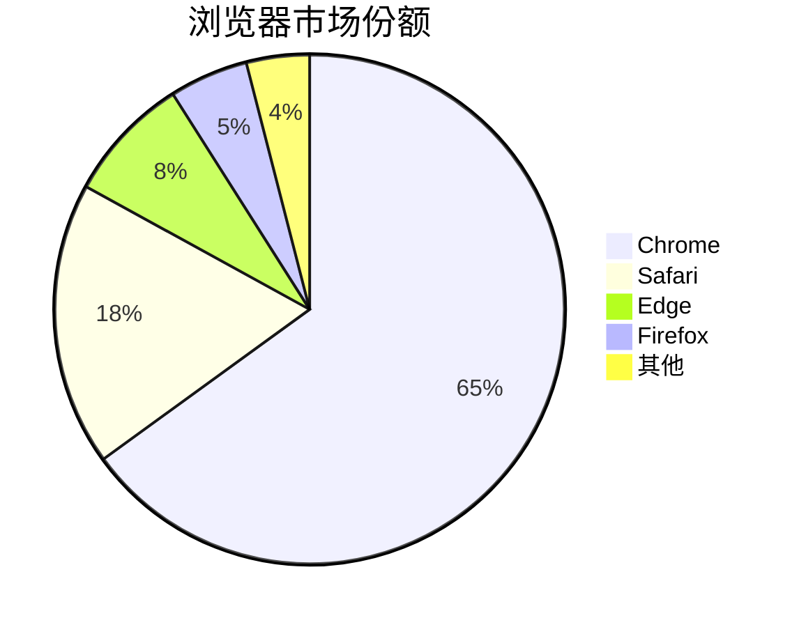
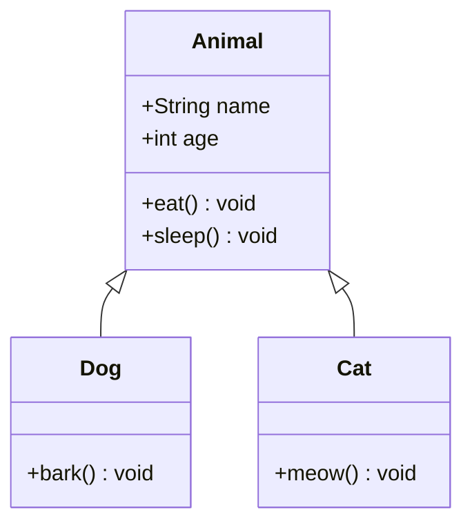

# 渲染示例

本页演示 Fast Wiki 支持的全部 Markdown 渲染能力，包括标题、文本、代码高亮、数学公式、Mermaid 图表、表格、引用、列表等。

## 文本排版

**加粗文本**、*斜体文本*、~~删除线~~、`行内代码`、[超链接](#/home)。

> 这是一段引用块。可用于强调重要信息或补充说明。

## 容器块

在代码中输入 `::: tip / info / warning / danger` 即可生成彩色提示框，容器名后可跟自定义标题：

::: tip
这是一个提示容器，默认标题为「提示」。
:::

::: info 信息
信息容器支持自定义标题，也可以包含 **加粗**、`行内代码` 等行内语法。
:::

::: warning
这里是直接动账的入口。每次充值前先核对该商户是否真的付过钱给你（线下转账记录），防止充错。
:::

::: danger 高危操作
危险容器用于不可逆操作的警示。
:::

## 列表

### 无序列表

- 第一项
- 第二项
    - 嵌套子项 A
    - 嵌套子项 B
- 第三项

### 有序列表

1. 第一步
2. 第二步
3. 第三步

## 代码高亮

系统原生集成 Prism.js，支持多种语言深色风格高亮。只需在代码块反引号后指定语言标识符。

### JavaScript

```javascript
class Wiki {
    constructor(name) {
        this.name = name;
        this.version = '1.2.0';
    }

    async load(path) {
        const res = await fetch(`docs/${path}`);
        if (!res.ok) throw new Error(`HTTP ${res.status}`);
        return await res.text();
    }
}

const wiki = new Wiki('Fast Wiki');
wiki.load('home.md').then(content => console.log(content));
```

### PHP

```php
<?php
// 扫描 docs 目录并生成菜单树
function scanDocs(string $dir): array {
    $result = [];
    foreach (scandir($dir) as $item) {
        if ($item[0] === '.' || $item[0] === '_') continue;
        $path = "{$dir}/{$item}";
        $result[] = is_dir($path)
            ? ['type' => 'dir', 'children' => scanDocs($path)]
            : ['type' => 'file', 'title' => $item];
    }
    return $result;
}

echo json_encode(scanDocs(__DIR__ . '/docs'), JSON_PRETTY_PRINT);
```

### Bash

```bash
# 启动 PHP 内置服务器
php -S localhost:8000

# 后台运行
nohup php -S 0.0.0.0:8000 > server.log 2>&1 &
```

### JSON

```json
{
    "name": "FastMD",
    "version": "1.2.0",
    "features": ["zero-build", "php-backend", "mermaid", "katex"],
    "engines": {
        "php": ">=8.0"
    }
}
```

## 数学公式（KaTeX）

系统原生集成 KaTeX，支持行内公式与块级公式。

### 行内公式

质能方程 $E = mc^2$ 是物理学最著名的公式之一。

### 块级公式

$$
\int_{-\infty}^{\infty} e^{-x^2} dx = \sqrt{\pi}
$$

### 多行对齐公式

$$
\begin{align}
f(x)  &= ax^2 + bx + c \\
f'(x) &= 2ax + b \\
f''(x)&= 2a
\end{align}
$$

### 矩阵

$$
A = \begin{pmatrix}
a_{11} & a_{12} & a_{13} \\
a_{21} & a_{22} & a_{23} \\
a_{31} & a_{32} & a_{33}
\end{pmatrix}
$$

## Mermaid 图表

在代码块语言标识处填写 `mermaid` 即可渲染图表。系统会根据当前系统主题自动切换浅色 / 深色样式。

### 流程图



### 时序图



### 甘特图



### 饼图



### 类图



## 表格

| 功能 | 引擎 | 说明 |
|---|---|---|
| Markdown 解析 | markdown-it | 支持 GFM 语法 |
| 代码高亮 | Prism.js | 深色主题 |
| 数学公式 | KaTeX | 行内与块级 |
| 图表绘制 | Mermaid | 自适应深色模式 |
| 全文搜索 | Fuse.js | 模糊匹配 |

## 分隔线

---

以上即 FastMD 支持的全部渲染能力。可在 [开发说明](#/dev) 中了解如何扩展。
