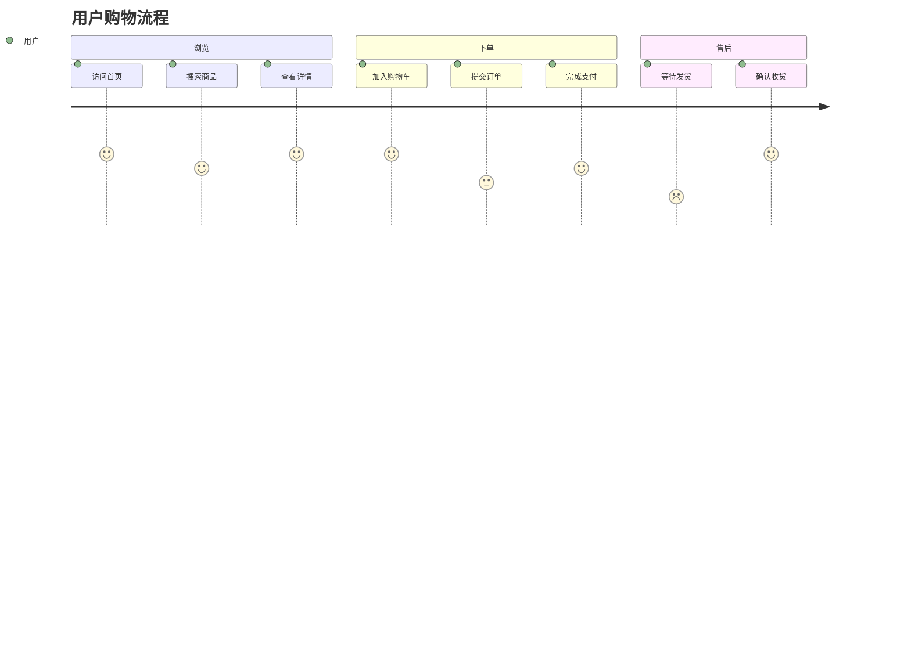
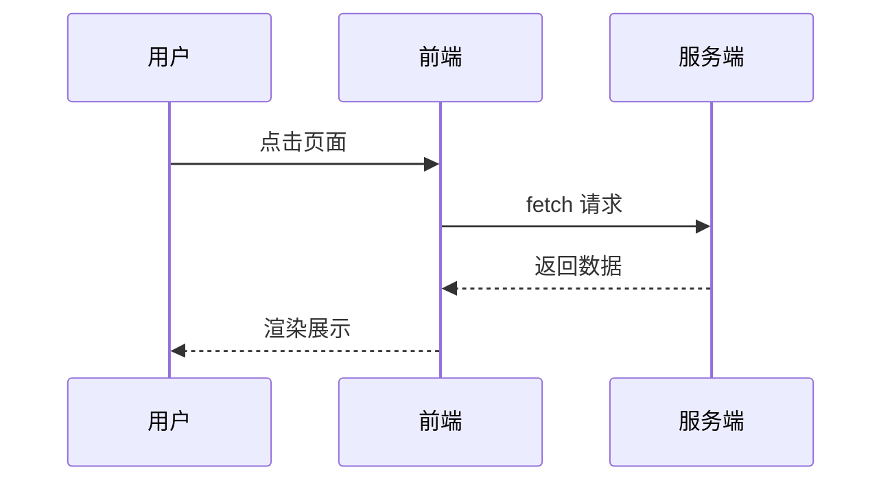
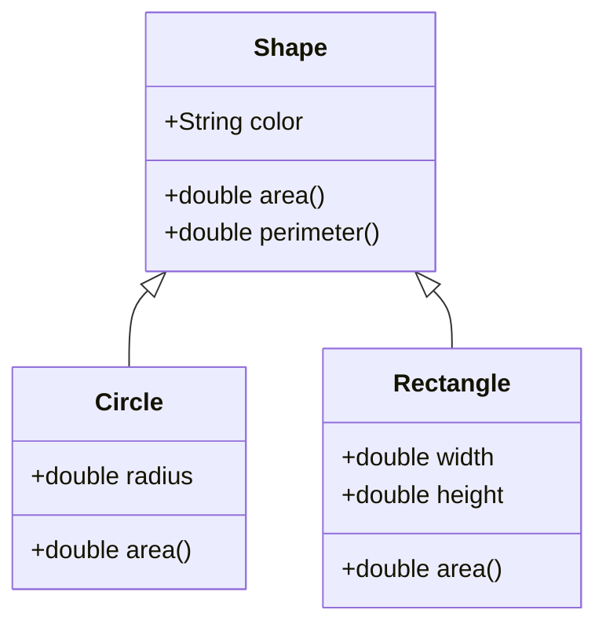
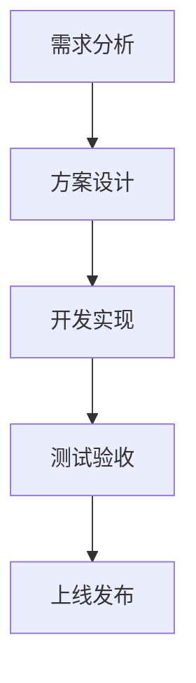
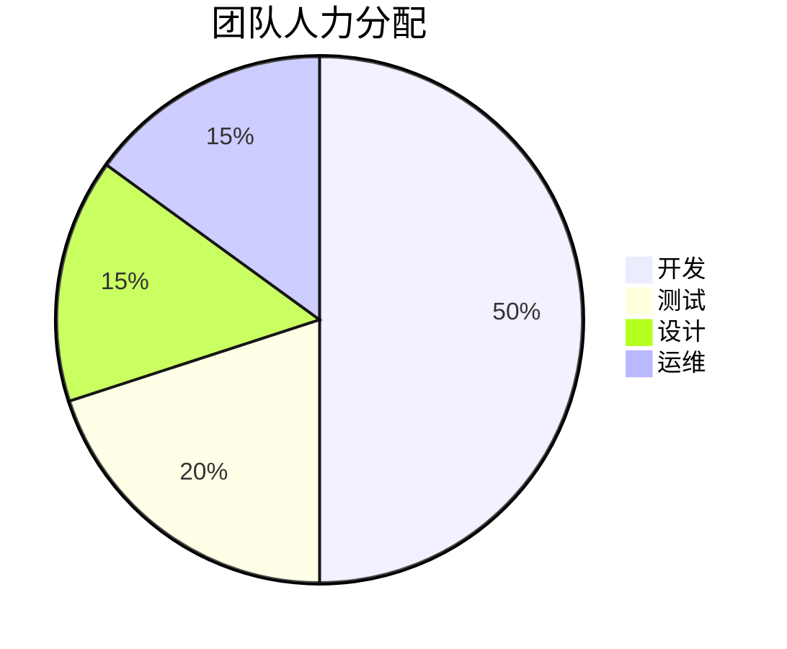

# 图表进阶

本页属于「进阶示例」多级菜单，演示更多 Mermaid 图表类型。

## 用户旅程图



## 时序图



## 类图



## 多图表组合

同一篇文档中可放置多个图表，系统会依次渲染：





## 渲染失败的处理

如果图表语法有误，系统会保留原始代码块并标红提示，不会影响其它内容渲染。例如：

```mermaid
flowchart LR
    A[开始] ->> B[结束]
```

> 上述代码使用了错误的箭头语法（`->>` 应为 `-->`），渲染时会显示为带红色虚线边框的代码块，便于作者定位问题。

继续阅读 [公式进阶](#/advanced/formula)。
